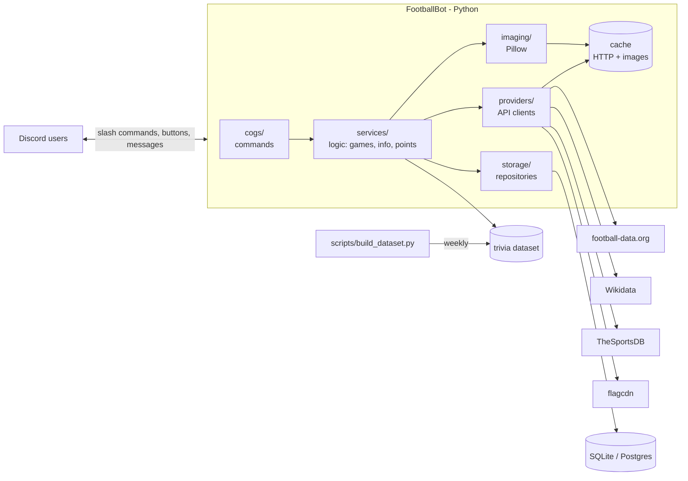

# Architecture

## Overview



The main rule: **commands never talk to the APIs directly.** They go through `services`, which decides whether to use the cache, the local dataset or call a provider. That way switching APIs does not break commands, and the free-tier limits hold up.

---

## Layers

| Layer | Responsibility | Must not |
|---|---|---|
| `cogs/` | Define slash commands, parse arguments, build embeds/views, reply | Contain game logic or HTTP calls |
| `services/` | Logic: trivia sessions, scoring, formatting football data, notifications | Know about Discord (other than simple types like IDs) |
| `providers/` | One client per API, all returning the **same models** (`Team`, `Match`, `Player`, `Standing`) | Return raw JSON upward |
| `imaging/` | Pure functions: `image bytes -> image bytes` (pixelate, blur, silhouette, cards) | Do network I/O |
| `storage/` | DB access through functions/repositories (`scores.add(...)`, `users.get(...)`) | Contain business logic |
| `models/` | Shared dataclasses / pydantic models | — |

Keeping `services` separate from `cogs` lets us **test the games without Discord**.

---

## Folder structure

```
FootballBot/
├── footballbot/
│   ├── __main__.py            # entry point: python -m footballbot
│   ├── bot.py                 # commands.Bot subclass, loads cogs, syncs commands
│   ├── config.py              # pydantic-settings, reads .env
│   ├── errors.py              # UserFacingError: messages safe to show as is
│   ├── cogs/
│   │   ├── common.py          # autocomplete, argument parsing, embed helpers
│   │   ├── info.py            # /matches /standings /team /player ...
│   │   ├── trivia.py          # /trivia start|stop, /leaderboard, answer buttons, round loop
│   │   ├── daily.py           # /daily
│   │   ├── social.py          # /profile /achievements (global /leaderboard later)
│   │   ├── follow.py          # /follow + periodic alert task
│   │   └── admin.py           # /config /ping /help
│   ├── services/
│   │   ├── football.py        # facade over providers + team index for autocomplete
│   │   ├── leagues.py         # supported competitions, codes, emoji, aliases
│   │   ├── text.py            # normalize(): lowercase, no accents (search and matching)
│   │   ├── trivia/
│   │   │   ├── dataset.py     # loads data/dataset/*.json into TriviaItems (+ aliases)
│   │   │   ├── session.py     # GameSession: state, answers and points of a game
│   │   │   ├── modes.py       # modes (crest, blur, league) + QuestionPicker
│   │   │   └── matching.py    # normalization + fuzzy + aliases
│   │   └── notifier.py
│   ├── providers/
│   │   ├── base.py            # FootballProvider protocol + provider errors
│   │   ├── ratelimit.py       # sliding window limiter (10 requests/minute)
│   │   ├── football_data.py
│   │   ├── thesportsdb.py
│   │   ├── wikidata.py
│   │   └── flags.py
│   ├── imaging/
│   │   ├── effects.py         # pixelate, blur, silhouette, zoom_crop, grayscale
│   │   ├── cards.py           # cards: standings, versus, profile, career path
│   │   ├── fonts/             # freely licensed .ttf fonts
│   │   └── loader.py          # download + disk cache
│   ├── storage/
│   │   ├── db.py              # SQLite connection + migrations (PRAGMA user_version)
│   │   ├── migrations/        # 001_init.sql, 002_..., never edit one already in main
│   │   └── repos.py           # save_game(), leaderboard()
│   └── models/                # football.py (Team, Match...) + trivia.py (TriviaItem...)
├── data/
│   ├── dataset/               # teams.json, leagues.json (generated, committed) + aliases.json (by hand)
│   └── cache/                 # downloaded images (gitignored)
├── scripts/
│   └── build_dataset.py       # builds the trivia dataset from the APIs
├── tests/
├── .env.example
├── pyproject.toml             # dependencies, ruff and pytest config
└── Dockerfile                 # (Phase 6)
```

---

## Data sources

All sources are free. Details, limits and sign-up links are in [APIS.md](APIS.md).

| Source | Used for |
|---|---|
| football-data.org | Matches, standings, scorers, teams and crests for 13 competitions |
| TheSportsDB | Crests, kits, stadiums, colors, year founded, players and career paths (trivia dataset) |
| flagcdn | Flags |
| Wikidata | Backup for player career paths |

**Strategy:**
- **Live info** (`/live`, `/matches`, `/standings`) -> football-data.org, short cache (30 s to 5 min). Free scores are delayed, so `/live` is not real time.
- **Trivia** -> never calls an API during a game. Uses the **local dataset** built weekly by `scripts/build_dataset.py`.
- **Players and career paths** -> squads from football-data.org, details and former clubs from TheSportsDB (Wikidata as backup), built offline into the dataset.

### Trivia dataset

Built by `python scripts/build_dataset.py` (run it again each season) and committed, so nobody else needs to run it. `data/dataset/teams.json`, one record per club:

```json
{
  "id": 86,
  "name": "Real Madrid CF",
  "short_name": "Real Madrid",
  "tla": "RMA",
  "country": "Spain",
  "leagues": ["PD", "CL"],
  "founded": 1902,
  "venue": "Estadio Santiago Bernabéu",
  "colors": "White / Purple",
  "crest_url": "https://crests.football-data.org/86.png",
  "difficulty": 1
}
```

`leagues.json` has the 13 competition logos for the `league` mode.

**Aliases** are maintained by hand in `aliases.json` (`{"id": 86, "name": "Real Madrid", "aliases": ["madrid", "los blancos", ...]}`) and merged in **when the bot loads the dataset**, so adding a nickname needs no rebuild. `name` is the name shown in the game; clubs without an entry use the API's short name. This file is what improves typed answers the most.

---

## Cache

| What | Where | Lifetime |
|---|---|---|
| HTTP responses | memory (`cachetools.TTLCache`) | per endpoint: 30 s live, 5 min matches, 10 min standings, 1 day teams |
| Team index (autocomplete) | memory, `FootballService` | loaded in the background at startup, refreshed daily |
| Original images | disk, `data/cache/img/<hash>.png` | indefinite |
| Processed images (pixelation stages) | memory, LRU | duration of the game |

Trivia uses the PNG crests (200x200) from football-data.org; `scripts/build_dataset.py` checks that every crest has a PNG and swaps `.svg` URLs for `.png`. No `cairosvg`, so there is no system library to install.

All football-data.org calls go through one `RateLimiter` (10 per minute, FIFO). On a 429 the provider waits for `X-RequestCounter-Reset` and retries once if that is under 20 s; otherwise the user gets a "try again in a minute" message.

**Autocomplete never calls an API**: Discord expects an answer in under 3 s, so team suggestions come from an in-memory index of every club in the 11 club competitions. National teams (World Cup, Euro) are left out because the free plan answers 403 for them. It is built at startup with one request every 12 s (about 2 minutes) to leave quota for commands.

---

## Image pipeline

```
URL -> loader (download + cache) -> PIL.Image -> effects/cards -> BytesIO (PNG/WebP) -> discord.File -> embed.set_image("attachment://x.png")
```

Base effects (`imaging/effects.py`), all pure functions:

| Effect | How |
|---|---|
| `pixelate(img, level)` | downscale to `w/n` with `NEAREST` and scale back up |
| `blur(img, radius)` | `ImageFilter.GaussianBlur` |
| `silhouette(img)` | use the alpha channel as a mask and fill solid black |
| `zoom_crop(img, stage)` | crop around a random point (seeded per game) that grows each stage |
| `grayscale(img)` | `ImageOps.grayscale` |

- All Pillow processing runs in `asyncio.to_thread(...)` so it **does not block the bot's event loop**.
- Neutral background for transparent crests (otherwise a black crest disappears in Discord's dark theme).
- Output size around 512 px: looks good and keeps files small.
- Cards (`cards.py`) use free `.ttf` fonts bundled in the repo.

---

## Trivia: game state

- `GameSession` lives **in memory**: `dict[channel_id, GameSession]`. One game per channel.
- Each round: pick answer -> render stage 0 image -> send -> loop with `asyncio.wait_for` waiting for an answer or the stage timeout -> next stage -> ... -> reveal.
- Answers:
  - **Buttons**: `discord.ui.View` with 4 `Button`s; track who already answered.
  - **Typed**: `on_message` listener filtered to channels with an active session -> `matching.is_correct(text, answer)`.
- `matching.py`: `unidecode` + lowercase + strip `fc`, `cf`, `club`, `de`... -> compare against name and aliases with `rapidfuzz.fuzz.ratio >= 85`.
- Points by stage: 100 / 75 / 50 / 25, plus +10 for each round won in a row (up to +50). Saved to the DB when the game ends.
- The first correct answer wins the round. Buttons: a wrong click locks that player out of the round. Typed: wrong guesses are free.
- Typed answers need the privileged *Message Content* intent, so they are behind `TRIVIA_TYPED_ANSWERS` (off by default).
- If the bot restarts mid-game, the game is lost (acceptable). Scores are what persists.

---

## Database

Built in Phase 2 (`storage/migrations/001_init.sql`):

```
games         (id, guild_id, channel_id, mode, difficulty, rounds, started_at, ended_at)
answers       (game_id, user_id, round, correct, stage, points, answered_at)
scores        (guild_id, user_id, mode, points, correct, answered, played, best_streak)   -- aggregate
```

Planned:

```
guilds        (id, trivia_channel_id, default_leagues, answer_mode, lang)
users         (id, created_at)
follows       (guild_id, channel_id, team_id)
daily         (date, mode, answer_id)
daily_results (date, user_id, attempts, solved)
achievements  (user_id, code, unlocked_at)
-- later: predictions, cards, user_cards
```

Simple migrations with numbered SQL files (`migrations/001_init.sql`); SQLite's `PRAGMA user_version` stores the last one applied and the bot applies the missing ones at startup. If we move to Postgres, use `asyncpg` behind the same `repos.py` interface.

---

## Discord details that matter

- **Slash commands** via `app_commands`. During development they sync only to the test server (`DISCORD_DEV_GUILD_ID`), which is instant; global sync takes longer.
- Reply in **under 3 s** or call `interaction.response.defer()` before hitting APIs or rendering images.
- **Intents**: `guilds` and `guild_messages`; `message_content` only if typed answers are used (it is privileged: enable it in the Developer Portal; past ~100 servers Discord requires verification).
- Attachment limit per message (~10 MB) is far above a 512 px PNG.
- Discord rate limits: do not edit the same message more than about once per second (matters for staged reveals: use 4-5 s stages).

---

## Background tasks

Using `discord.ext.tasks`:

| Task | Frequency | What it does |
|---|---|---|
| `poll_live` | 60 s (only if a followed team is playing) | Detects goals/kick-off/full-time and sends alerts |
| `rotate_daily` | 00:00 (America/Bogota) | Picks the player/crest of the day |
| `prune_cache` | daily | Deletes old images |

---

## Where JavaScript fits

The core is Python. JS/TS only comes in where it adds value:
- **Web dashboard** (public leaderboards, card album) — e.g. Next.js reading the same DB or a small FastAPI API.
- Card rendering with `satori`/canvas is possible, but keeping a single image tool (Pillow) is simpler.

---

## Testing

- `pytest` + `pytest-asyncio`.
- Providers tested against **recorded responses** (JSON in `tests/fixtures/`), without spending API quota.
- `imaging` tested by checking output sizes/modes (plus manual screenshots in PRs).
- `services/trivia` tested without Discord: simulated session with fake answers.

---

## Deployment

- `Dockerfile` (python-slim; Pillow wheels need no system libraries).
- Options: a cheap VPS, Railway/Fly.io, or a Raspberry Pi at home. It must run 24/7 for `/follow` and `/daily`.
- Standard `logging` to stdout; command errors are reported to a private channel on the dev server.

## Error handling

`bot.on_app_command_error` turns every exception into a short ephemeral message:

| Error | User sees | Reported to `#errors` |
|---|---|---|
| `UserFacingError` | its message (bad date, unknown league or team...) | No |
| `NotInPlanError` (API 403, e.g. a national team) | "isn't included in the free football data plan" | No |
| `NotFoundError` / `RateLimitedError` / `ProviderError` | "couldn't find that" / "API busy" / "service not responding" | No (logged) |
| Anything else | "Something went wrong" | Yes, with traceback |

---

## Decisions (and why)

| Decision | Reason |
|---|---|
| `discord.py` over `py-cord`/`nextcord` | Most used and best documented; has views, modals and autocomplete |
| Trivia from a local dataset, not live API calls | Free quotas cannot sustain a 20-round game across several servers |
| SQLite first | Zero setup; moving to Postgres stays isolated in `storage/` |
| Pillow for all images | One tool, runs anywhere, fast at 512 px |
| Providers with shared models | Swap or combine APIs without touching commands |
