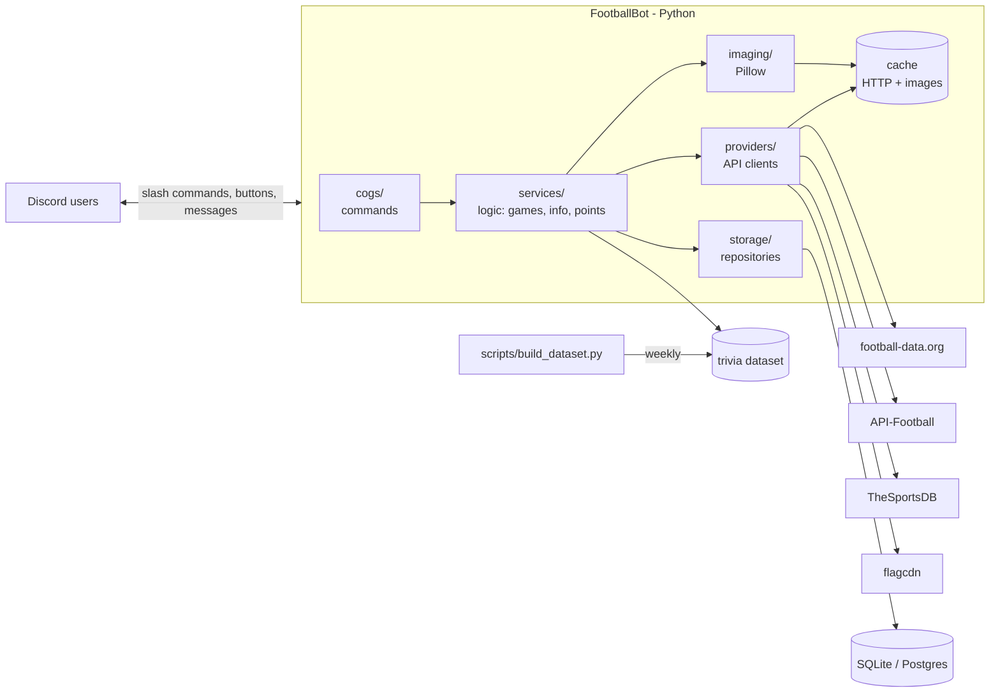

# Architecture

## Overview



The main rule: **commands never talk to the APIs directly.** They go through `services`, which decides whether to use the cache, the local dataset or call a provider. That way switching APIs does not break commands, and the free-tier limits hold up.

---

## Layers

| Layer | Responsibility | Must not |
|---|---|---|
| `cogs/` | Define slash commands, parse arguments, build embeds/views, reply | Contain game logic or HTTP calls |
| `services/` | Logic: trivia sessions, scoring, formatting football data, notifications | Know about Discord (other than simple types like IDs) |
| `providers/` | One client per API, all returning the **same models** (`Team`, `Match`, `Player`, `Standing`) | Return raw JSON upward |
| `imaging/` | Pure functions: `image bytes -> image bytes` (pixelate, blur, silhouette, cards) | Do network I/O |
| `storage/` | DB access through functions/repositories (`scores.add(...)`, `users.get(...)`) | Contain business logic |
| `models/` | Shared dataclasses / pydantic models | — |

Keeping `services` separate from `cogs` lets us **test the games without Discord**.

---

## Folder structure

```
FootballBot/
├── footballbot/
│   ├── __main__.py            # entry point: python -m footballbot
│   ├── bot.py                 # commands.Bot subclass, loads cogs, syncs commands
│   ├── config.py              # pydantic-settings, reads .env
│   ├── cogs/
│   │   ├── info.py            # /matches /standings /team /player ...
│   │   ├── trivia.py          # /trivia, /hint, answer buttons
│   │   ├── daily.py           # /daily
│   │   ├── social.py          # /leaderboard /profile /achievements
│   │   ├── follow.py          # /follow + periodic alert task
│   │   └── admin.py           # /config /ping /help
│   ├── services/
│   │   ├── football.py        # facade over providers + cache
│   │   ├── trivia/
│   │   │   ├── session.py     # GameSession: state of a game in a channel
│   │   │   ├── modes.py       # one question generator per mode
│   │   │   └── matching.py    # normalization + fuzzy + aliases
│   │   ├── scoring.py
│   │   └── notifier.py
│   ├── providers/
│   │   ├── base.py            # FootballProvider protocol
│   │   ├── football_data.py
│   │   ├── api_football.py
│   │   ├── thesportsdb.py
│   │   └── flags.py
│   ├── imaging/
│   │   ├── effects.py         # pixelate, blur, silhouette, zoom_crop, grayscale
│   │   ├── cards.py           # cards: standings, versus, profile, career path
│   │   ├── fonts/             # freely licensed .ttf fonts
│   │   └── loader.py          # download + disk cache + SVG to PNG
│   ├── storage/
│   │   ├── db.py
│   │   ├── migrations/
│   │   └── repos.py
│   └── models/
├── data/
│   ├── dataset/               # teams.json, players.json, aliases.json (generated)
│   └── cache/                 # downloaded images (gitignored)
├── scripts/
│   └── build_dataset.py       # builds the trivia dataset from the APIs
├── tests/
├── .env.example
├── requirements.txt / pyproject.toml
└── Dockerfile
```

---

## Data sources

> Free-tier limits change; **verify them when creating the accounts** and record the real numbers here.

| Source | Used for | Free tier (approx.) | Notes |
|---|---|---|---|
| [football-data.org](https://www.football-data.org/) | Matches, standings, scorers, teams for the major leagues | ~10 requests/min, ~12 competitions | Includes each team's crest URL. Good for daily data |
| [API-Football (api-sports.io)](https://www.api-football.com/) | Everything: many leagues, players with photos, stats, transfers, live | ~100 requests/**day** | Player photos and logos on their CDN. Use sparingly |
| [TheSportsDB](https://www.thesportsdb.com/) | Crests, **stadium photos**, kits, banners, colors, year founded | Free test key | Ideal for the trivia dataset |
| [flagcdn.com](https://flagcdn.com/) | Flags by ISO code (`/w320/co.png`) | Free | For `flag`, `club-country`, nationalities |

**Strategy:**
- **Live info** (`/live`, `/matches`, `/standings`) -> football-data.org, short cache (30 s to 5 min).
- **Trivia** -> never calls an API during a game. Uses the **local dataset** built weekly by `scripts/build_dataset.py`.
- **Players and career paths** -> API-Football, cached for days (they rarely change).

### Trivia dataset

Generated file (`data/dataset/teams.json`), example record:

```json
{
  "id": "fd-86",
  "name": "Real Madrid CF",
  "aliases": ["real madrid", "madrid", "los blancos", "rmcf"],
  "country": "ES",
  "league": "PD",
  "founded": 1902,
  "stadium": "Santiago Bernabeu",
  "stadium_capacity": 83186,
  "colors": ["#FFFFFF", "#00529F"],
  "crest_url": "https://...",
  "stadium_img_url": "https://...",
  "difficulty": 1
}
```

**Aliases** are maintained by hand in `aliases.json` and merged in when generating (this is the part that improves typed answers the most).

---

## Cache

| What | Where | Lifetime |
|---|---|---|
| HTTP responses | memory (`cachetools.TTLCache`) | per endpoint: 30 s live, 1 h standings, 1 day teams |
| Original images | disk, `data/cache/img/<hash>.png` | indefinite |
| Processed images (pixelation stages) | memory, LRU | duration of the game |

SVG crests are converted to PNG with `cairosvg` when downloaded.

---

## Image pipeline

```
URL -> loader (download + cache) -> PIL.Image -> effects/cards -> BytesIO (PNG/WebP) -> discord.File -> embed.set_image("attachment://x.png")
```

Base effects (`imaging/effects.py`), all pure functions:

| Effect | How |
|---|---|
| `pixelate(img, level)` | downscale to `w/n` with `NEAREST` and scale back up |
| `blur(img, radius)` | `ImageFilter.GaussianBlur` |
| `silhouette(img)` | use the alpha channel as a mask and fill solid black |
| `zoom_crop(img, stage)` | crop around a random point (seeded per game) that grows each stage |
| `grayscale(img)` | `ImageOps.grayscale` |

- All Pillow processing runs in `asyncio.to_thread(...)` so it **does not block the bot's event loop**.
- Neutral background for transparent crests (otherwise a black crest disappears in Discord's dark theme).
- Output size around 512 px: looks good and keeps files small.
- Cards (`cards.py`) use free `.ttf` fonts bundled in the repo.

---

## Trivia: game state

- `GameSession` lives **in memory**: `dict[channel_id, GameSession]`. One game per channel.
- Each round: pick answer -> render stage 0 image -> send -> loop with `asyncio.wait_for` waiting for an answer or the stage timeout -> next stage -> ... -> reveal.
- Answers:
  - **Buttons**: `discord.ui.View` with 4 `Button`s; track who already answered.
  - **Typed**: `on_message` listener filtered to channels with an active session -> `matching.is_correct(text, answer)`.
- `matching.py`: `unidecode` + lowercase + strip `fc`, `cf`, `club`, `de`... -> compare against name and aliases with `rapidfuzz.fuzz.ratio >= 85`.
- Points = base x stage multiplier (faster means more points) + streak bonus. Saved to the DB when the game ends.
- If the bot restarts mid-game, the game is lost (acceptable). Scores are what persists.

---

## Database (draft)

```
guilds        (id, trivia_channel_id, default_leagues, answer_mode, lang)
users         (id, created_at)
games         (id, guild_id, channel_id, mode, difficulty, started_at, ended_at)
answers       (game_id, user_id, round, correct, stage, points, answered_at)
scores        (guild_id, user_id, mode, points, correct, played, best_streak)   -- aggregate
follows       (guild_id, channel_id, team_id)
daily         (date, mode, answer_id)
daily_results (date, user_id, attempts, solved)
achievements  (user_id, code, unlocked_at)
-- later: predictions, cards, user_cards
```

Simple migrations with numbered SQL files (`migrations/001_init.sql`). If we move to Postgres, use `asyncpg` behind the same `repos.py` interface.

---

## Discord details that matter

- **Slash commands** via `app_commands`. During development they sync only to the test server (`DISCORD_DEV_GUILD_ID`), which is instant; global sync takes longer.
- Reply in **under 3 s** or call `interaction.response.defer()` before hitting APIs or rendering images.
- **Intents**: `guilds` and `guild_messages`; `message_content` only if typed answers are used (it is privileged: enable it in the Developer Portal; past ~100 servers Discord requires verification).
- Attachment limit per message (~10 MB) is far above a 512 px PNG.
- Discord rate limits: do not edit the same message more than about once per second (matters for staged reveals: use 4-5 s stages).

---

## Background tasks

Using `discord.ext.tasks`:

| Task | Frequency | What it does |
|---|---|---|
| `poll_live` | 60 s (only if a followed team is playing) | Detects goals/kick-off/full-time and sends alerts |
| `rotate_daily` | 00:00 (America/Bogota) | Picks the player/crest of the day |
| `prune_cache` | daily | Deletes old images |

---

## Where JavaScript fits

The core is Python. JS/TS only comes in where it adds value:
- **Web dashboard** (public leaderboards, card album) — e.g. Next.js reading the same DB or a small FastAPI API.
- Card rendering with `satori`/canvas is possible, but keeping a single image tool (Pillow) is simpler.

---

## Testing

- `pytest` + `pytest-asyncio`.
- Providers tested against **recorded responses** (JSON in `tests/fixtures/`), without spending API quota.
- `imaging` tested by checking output sizes/modes (plus manual screenshots in PRs).
- `services/trivia` tested without Discord: simulated session with fake answers.

---

## Deployment

- `Dockerfile` (python-slim + libcairo for SVG).
- Options: a cheap VPS, Railway/Fly.io, or a Raspberry Pi at home. It must run 24/7 for `/follow` and `/daily`.
- Standard `logging` to stdout; command errors are reported to a private channel on the dev server.

---

## Decisions (and why)

| Decision | Reason |
|---|---|
| `discord.py` over `py-cord`/`nextcord` | Most used and best documented; has views, modals and autocomplete |
| Trivia from a local dataset, not live API calls | Free quotas cannot sustain a 20-round game across several servers |
| SQLite first | Zero setup; moving to Postgres stays isolated in `storage/` |
| Pillow for all images | One tool, runs anywhere, fast at 512 px |
| Providers with shared models | Swap or combine APIs without touching commands |
