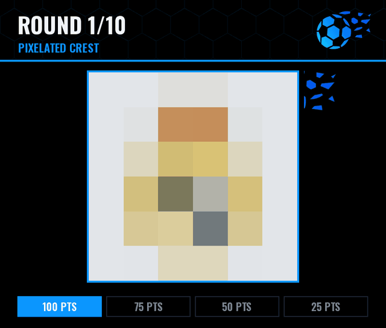

# FootballBot

A Discord bot about football: **live league information** (matches, standings, team profiles) and **image trivia** in the style of country-flag quiz bots, but with club crests: guess the club from a pixelated crest, a silhouette or a zoomed-in piece, the country of a club, the national team from its flag, and more.

<p align="center">
  
</p>

<sub>The preview shows the real images the bot sends, made with real data by <code>scripts/make_preview.py</code>.</sub>

> **Status:** the MVP (Phases 0-2) is done, plus the crest and flag modes of Phase 3 and the image cards of Phase 4, all in the bot's own look. Next: player trivia, alerts and running it 24/7. See [ROADMAP.md](ROADMAP.md).

---

## What it does

### Football info
| Command | What you get |
|---|---|
| `/matches [league] [date]` | The day's matches in one compact message, a section per league, winners in bold |
| `/live [league]` | Matches being played right now (free data is a few minutes behind) |
| `/standings <league>` | **Image card** of the table: crests, positions colored by zone (Champions League, relegation...) and the leader on top |
| `/team <team>` | **Image card**: crest, stadium, coach, W/D/L form, last result and the next match as a "versus", plus a link to the club's website |
| `/leagues` | The 13 supported competitions and their codes |

Leagues, teams and dates have autocomplete. Data covers the 13 competitions of football-data.org's free plan: the top 5 European leagues, Eredivisie, Primeira Liga, Championship, Brasileirão, Champions League, Copa Libertadores, World Cup and Euro.

### Trivia
`/trivia start <mode> [difficulty] [rounds] [answers]` starts a game in the channel. The image gets clearer every 5 seconds; answering earlier gives more points (100 / 75 / 50 / 25), and winning rounds in a row adds a streak bonus.

| Mode | You see | You guess |
|---|---|---|
| Pixelated crest | A pixelated crest | The club |
| Blurred crest | A blurred crest | The club |
| Silhouette | The crest filled in blue (its colors fade in) | The club |
| Zoomed crest | A small piece of the crest that zooms out | The club |
| Club country | A crest | Its country (buttons with flags) |
| Flags | A pixelated flag | The national team |
| League logo | A pixelated league logo | The competition |
| Mix | A different crest mode each round | The club |

- **Answers:** 4 buttons, or typed in the chat (accents, typos and nicknames like `barca`, `atleti` or `spurs` all count).
- **Difficulty:** easy (top 5 leagues), medium (more European and Brazilian clubs), hard (Championship and Libertadores too).
- **No repeats:** each server remembers which crests already came up, so you don't see the same one until all of them have.
- Each round is an image card with the question and the points still up for grabs; the answer is revealed on another card with the club, its country and league, and who got it.
- `/trivia hint` gives a private hint (costs points), `/trivia stop` ends the game, and every game ends with a **podium** with the players' avatars.
- `/leaderboard [mode]`: the server ranking as an image card.

### Utilities
`/help` (commands by category, `/help <command>` for its options) and `/ping` (Discord latency, football API status and quota).

The full catalog, including what is planned, is in [COMMANDS.md](COMMANDS.md).

---

## Look

Everything the bot sends follows its logo: a blue ball breaking into fragments on black.

- **Cards** (standings, team, trivia rounds, answers, podium, leaderboard) are drawn by the bot with Pillow: flat black, one electric blue (`#0B96FE`), square corners, the logo as a mark in the header and its fragments as decoration.
- **Crests are stickers**: a light outline that follows their shape, so dark crests (Juventus, Newcastle) still show on black.
- **Text is sized for phones**, where Discord shrinks images to about 400 px wide.
- **Messages** use the same blue, keep emojis to flags and a few status marks, and never repeat what the image already shows. Cards go out as plain images (Discord shows them bigger), times are Discord timestamps (everyone sees their own timezone), commands are clickable, and dead ends get a button (next day, today's matches, play again).

To change the look, start with the palette at the top of [`footballbot/imaging/draw.py`](footballbot/imaging/draw.py); [GUIA.md](GUIA.md) explains where each card lives.

---

## Stack

| Part | Technology |
|---|---|
| Main language | **Python 3.12+** |
| Discord | [`discord.py`](https://discordpy.readthedocs.io/) 2.x (slash commands, buttons, select menus, autocomplete) |
| HTTP | `httpx` (async) |
| Images | `Pillow` with the free Inter and Oswald fonts, styled after the bot's logo |
| Database | SQLite with `aiosqlite` (numbered migrations), PostgreSQL if it grows |
| Answer matching | `rapidfuzz` + `unidecode` |
| Config | `.env` + `pydantic-settings` |
| Quality | `ruff`, `pytest`, GitHub Actions |
| Extra (optional) | JS/TS for a web leaderboard dashboard later on |

Data sources, all free (see [APIS.md](APIS.md)): **football-data.org** (matches, tables, teams, crests) and **flagcdn** (flags) today; **TheSportsDB** and **Wikidata** come in with the player modes.

---

## Documents

| File | Purpose |
|---|---|
| [README.md](README.md) | This overview |
| [GUIA.md](GUIA.md) | **Code guide (Spanish)**: where everything is and how a command flows through the bot. Start here before touching the code |
| [ROADMAP.md](ROADMAP.md) | Phases, tasks and work areas to split between us |
| [ARCHITECTURE.md](ARCHITECTURE.md) | How the bot is built internally: folders, data, images |
| [APIS.md](APIS.md) | Free APIs we use, their limits and sign-up links |
| [COMMANDS.md](COMMANDS.md) | Catalog of every command and trivia mode |
| [CONTRIBUTING.md](CONTRIBUTING.md) | Team rules: branches, commits, PRs, code style |

---

## Getting started

```bash
git clone https://github.com/Juan-Miguel-alvarado/FootballBot.git && cd FootballBot
python -m venv .venv && source .venv/bin/activate
pip install -e ".[dev]"
cp .env.example .env      # then fill in the keys
python -m footballbot
```

Environment variables (all documented in [.env.example](.env.example)):

```env
DISCORD_TOKEN=
DISCORD_DEV_GUILD_ID=        # test server: slash commands sync instantly there
DISCORD_ERRORS_CHANNEL_ID=   # optional: channel that receives error tracebacks
FOOTBALL_DATA_KEY=
THESPORTSDB_KEY=123          # public free key
DATABASE_URL=sqlite:///data/footballbot.db
TRIVIA_TYPED_ANSWERS=false  # true only after enabling the Message Content intent
TIMEZONE=America/Bogota      # "today" and kick-off times
LOG_LEVEL=INFO
```

Checks (the same ones CI runs on every PR):

```bash
ruff check . && ruff format --check .
pytest
```

Scripts:

```bash
python scripts/build_dataset.py   # rebuild the trivia clubs and league logos (each season)
python scripts/make_preview.py    # regenerate docs/preview.gif after changing the card design
```

> Never commit `.env` or the bot token. If a token leaks, regenerate it in the Discord Developer Portal immediately.

---

## Disclaimer

Crests, logos and player photos are trademarks/property of their owners. This is a **non-commercial** project among friends; images are only used for the trivia games and are cached from the APIs, not redistributed.
